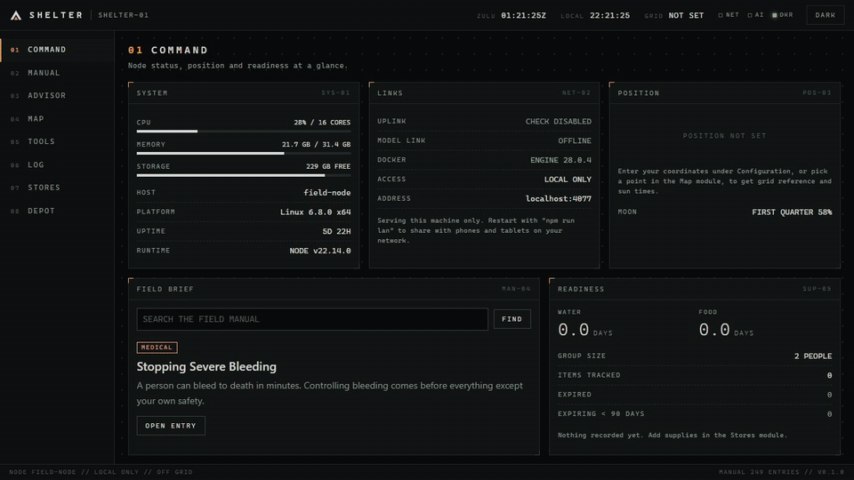

<div align="center">


# SHELTER

**A survival computer that keeps working when the internet doesn't.**

A field manual, a local AI advisor, an offline map and field tools that run on hardware you own: an old laptop, a mini PC or a home server. No cloud and no accounts, and after install no internet.

[](LICENSE)


[](https://github.com/guidoaguiar/project-shelter/stargazers)

[Install](#install) · [Modules](#modules) · [Local AI](#local-ai) · [Add your own content](#adding-to-the-manual)

</div>



## Why Shelter

- **249-entry survival manual**, with 167 figures and ranked full-text search: water, fire, shelter, food, navigation, medical, signals and more.
- **A local AI advisor that cites its sources.** It answers from the manual and links the entries it used. With no model installed, it still returns the closest entries.
- **An offline street map.** While you have a link, download your area once: roads, footpaths, tracks, rivers, buildings, place names, and water points, clinics, fuel and shelters from OpenStreetMap. After that it works with no internet, with waypoints, a scale bar, and range and bearing from home.
- **Field tools:** UTM and MGRS conversion, sun and moon times, Morse with audio, water disinfection dosing, pace counts.
- **Supply tracking** that tells you how many days of food and water you have and warns before items expire.
- **A one-click Depot** for 19 more offline services: Kiwix (offline Wikipedia), Kolibri, Calibre-Web, Open WebUI and others.
- **Night-vision mode:** a red-only display that preserves your dark adaptation.
- **Small and hackable:** one container, a zero-dependency Node server, no build step, and the whole manual is Markdown you can edit.

### Try it in one line

```
curl -fsSL https://raw.githubusercontent.com/guidoaguiar/project-shelter/main/install/install.sh -o install.sh && sudo bash install.sh
```

Then open http://localhost:4077. That is Linux; the macOS and Windows commands, and a way to read the script before running it, are under [Install](#install).

### Shelter and Project N.O.M.A.D.

Shelter was inspired by [Project N.O.M.A.D.](https://github.com/crosstalk-solutions/project-nomad). It is an independent project and shares no code with it. Shelter's focus:

- **Knowledge built in.** The survival manual, the AI advisor grounded in it, the map and the field tools all work out of the box. Extra services are optional.
- **Runs where you already are.** One-line installers for Linux, macOS and Windows, or `node server.js` with no dependencies at all.
- **Plain files.** Your notes, supplies and waypoints live in a data folder you can copy to back up. The manual is Markdown in this repository.

> **Note:** The manual is a reference, not a substitute for training or professional medical care. Shelter has no login, so do not expose it to the internet.

## Install

Shelter runs in Docker, which also runs its local AI and the Depot services. The installers set up Docker for you.

**Linux is the recommended host.** Use a dedicated machine or a mini PC running Ubuntu 24.04 LTS or newer, or Debian 12 or newer. macOS and Windows work through Docker Desktop, which must be running for Shelter to be up, and they have one limitation (see [Platform notes](#platform-notes)).

| | Minimum | Recommended (with local AI) |
|---|---|---|
| CPU | 64-bit, 2 cores | 4+ cores |
| RAM | 2 GB | 8 GB or more |
| Disk | 5 GB free | 50 GB+ for AI models and offline libraries |

You need an internet connection during install. After that, Shelter works offline.

Shelter has no login. Do not expose it to the internet.

### Quick install

Open a terminal and paste the line for your system. The installer checks for Docker and installs it if missing, downloads Shelter and starts it. It asks a few questions; pressing Enter accepts the default:

- the port (default 4077)
- whether phones and tablets on your network may connect (default no)
- whether to set up the local AI now (Ollama with `llama3.2:3b`, about 2.5 GB)

**Linux** (Ubuntu, Debian, Raspberry Pi OS, Fedora, Arch and others):

```
curl -fsSL https://raw.githubusercontent.com/guidoaguiar/project-shelter/main/install/install.sh -o install.sh && sudo bash install.sh
```

**macOS** (install [Docker Desktop](https://www.docker.com/products/docker-desktop/) or [OrbStack](https://orbstack.dev) first, or let the installer use Homebrew):

```
curl -fsSL https://raw.githubusercontent.com/guidoaguiar/project-shelter/main/install/install.sh -o install.sh && bash install.sh
```

**Windows 10/11** (PowerShell, not as administrator):

```
powershell -ExecutionPolicy Bypass -c "irm https://raw.githubusercontent.com/guidoaguiar/project-shelter/main/install/install.ps1 | iex"
```

Prefer to read the script before running it? The commands above download it first; on Linux and macOS you can open `install.sh` before the `sudo bash` step, or read [install/install.sh](install/install.sh) and [install/install.ps1](install/install.ps1) here.

When the installer finishes, open http://localhost:4077. Shelter starts again on its own after a reboot. On macOS and Windows that requires Docker Desktop to start at sign-in, which is its default.

| | Linux | macOS | Windows |
|---|---|---|---|
| Program files | `/opt/shelter/app` | `~/Shelter/app` | `%USERPROFILE%\Shelter\app` |
| Your data | `/opt/shelter/data` | `~/Shelter/data` | `%USERPROFILE%\Shelter\data` |

**Update:** run the same command again. Your data, settings, added manual files and `depot.custom.json` are kept, but edits to built-in manual files are replaced. On Linux you can also run `sudo shelter update`.

**Manage (Linux and macOS):** `shelter status | logs | stop | start | restart | update | open`. On macOS the command is `~/Shelter/shelter`.

**Uninstall:** run the installer with `--uninstall` (Linux, macOS) or `-Uninstall` (Windows). It asks before deleting your data.

**Installer options:**

| Linux, macOS | Windows | Effect |
|---|---|---|
| `--port N` | `-Port N` | Web interface port |
| `--lan` / `--local` | `-Lan` / `-Local` | Serve your network, or this machine only |
| `--ai` / `--no-ai` | `-Ai` / `-NoAi` | Set up the local AI, or skip the question |
| `--dir PATH` | `-Dir PATH` | Install somewhere else |
| `--yes` | `-Yes` | Accept all defaults without asking |
| `--branch NAME` | `-Branch NAME` | Install another branch |
| `--source PATH` | `-Source PATH` | Install from a local checkout |

Pass options after the script name: `sudo bash install.sh --lan --no-ai`. On Windows, use this form:

```
& ([scriptblock]::Create((irm https://raw.githubusercontent.com/guidoaguiar/project-shelter/main/install/install.ps1))) -Lan -NoAi
```

### Advanced install

For people who know Docker and want to manage the stack themselves. The installers do exactly this.

```
git clone https://github.com/guidoaguiar/project-shelter.git
cd project-shelter
cp .env.example .env        # set SHELTER_DATA_DIR to an absolute path, pick the COMPOSE_FILE line for your OS
docker compose up -d --build
```

The stack is one container built from the [Dockerfile](Dockerfile). It holds Node and the Docker CLI, and the Depot uses the CLI to manage service containers through the host's Docker socket. The [compose.yaml](compose.yaml) file holds the shared settings, and `.env` adds one override through `COMPOSE_FILE`:

- [compose.host.yaml](compose.host.yaml) (Linux): host networking. Shelter sees the real network interfaces, binds like a native process, and reaches Ollama and Depot services on `127.0.0.1`.
- [compose.desktop.yaml](compose.desktop.yaml) (Docker Desktop): a bridged network, with the port published on `SHELTER_BIND` and Ollama reached through `host.docker.internal`.

`content/` and `config/` are mounted read-only, so manual edits and `depot.custom.json` take effect without a rebuild. Data lives in `SHELTER_DATA_DIR`, mounted at `/data`. Depot services get bind mounts under `SHELTER_DATA_DIR/depot/<id>`, and the Docker daemon resolves those on the host, which is why Shelter needs the host path.

The Docker socket gives Shelter full control of Docker on the host. If you do not want the Depot, remove that volume line. The Depot then shows Docker as offline, and everything else still works.

### From source, without Docker

For development. Requires Node.js 20 or newer. There are no dependencies to install.

```
node server.js          # http://localhost:4077
node server.js --lan    # also serve phones and tablets on your network
```

The Depot then uses the Docker CLI on the same machine, if there is one.

### Platform notes

- **Linux** runs Shelter with host networking, so it behaves like a native install. The Depot can tell the host machine apart from other devices, so its controls stay available on the host in network mode.
- **macOS and Windows** run Shelter inside Docker Desktop's virtual machine. Docker Desktop hides where requests come from, so in network mode Shelter cannot tell your computer from a phone. The Depot's start/stop buttons are therefore off in network mode on these systems, unless you set `SHELTER_REMOTE_ADMIN=1`, which allows them for every device on your network. In local mode they work normally.
- **Windows:** Docker Desktop must use Linux containers (its default). On first network use, Windows Firewall may ask about Docker; allow it on private networks.

## Modules

| # | Module | What it does |
|---|---|---|
| 01 | Command | Host telemetry, link status, grid position, sun and moon, supply readiness, configuration |
| 02 | Manual | 249 entries in 14 sections, with figures and ranked full-text search. Each section opens with short essentials, followed by full chapters |
| 03 | Advisor | Chat with a local model, grounded in the manual and citing entries. With no model it returns the closest entries instead |
| 04 | Map | World outline everywhere, plus downloadable street maps (roads, paths, tracks, water, buildings, key points) that work offline. Waypoints, range and bearing from home |
| 05 | Tools | Coordinate conversion (DD, DMS, UTM, MGRS), sun and moon times, Morse with audio, water disinfection dosing, pace and bearing, encoding and hashing |
| 06 | Log | Markdown notes saved on the node |
| 07 | Stores | Supply inventory with days of water and food, and expiry warnings |
| 08 | Depot | Deploys 19 services as Docker containers, in six categories: knowledge (Kiwix, Kolibri, Calibre-Web, DokuWiki), AI (Ollama, Open WebUI), tools, vault, homestead and media. Each card links to where its content comes from |

The display button in the top bar cycles three modes: dark, night vision (red only, to preserve dark adaptation) and daylight.

## Local AI

The Advisor talks to [Ollama](https://ollama.com). The installers can set it up for you. Otherwise, deploy Ollama from the Depot, or install it natively, then pull a model:

```
docker exec shelter-ollama ollama pull llama3.2:3b
```

The AI indicator in the top bar then turns on. On Linux with an NVIDIA GPU and the NVIDIA Container Toolkit, the installer gives Ollama the GPU.

The default address is `http://127.0.0.1:11434` on Linux and `http://host.docker.internal:11434` under Docker Desktop.

Any OpenAI-compatible server (LM Studio, llama.cpp) also works: choose it under Command, Configuration, and include `/v1` in the URL.

## Manual content

The manual is one library in two layers. The files directly in `content/manual` are the short essentials that open each section. The 33 full chapters live in `content/manual/chapters`, one Markdown file per chapter, with their 167 figures in `content/manual/chapters/img`.

All of it is plain Markdown in this repository: edit the files and commit.

## Adding to the manual

Drop a Markdown file into `content/manual`. On an installed node, that is `app/content/manual` in the install folder, for example `/opt/shelter/app/content/manual`. It is picked up without a restart.

```markdown
# Title of the Entry
tags: optional, comma, separated

The first paragraph is the summary shown in search results.

## A section
```

The file name sets the section (`11-vehicles.md` becomes VEHICLES). Each line starting with a single `#` begins a new entry.

To file entries under an existing section, or as a chapter within it, start the file with `category: WATER` and, optionally, `group: Chapter Name`. Files may also sit in a subfolder, with figures in its `img/` folder referenced as ``.

## Offline street maps

The Map module always shows a world outline. To get roads and paths, download your area while you have an internet link:

1. Open **Map** on the host machine, then pan and zoom until your area fills the map.
2. Under **Offline maps**, name the area, pick a detail level and choose **Download visible area**.

| Detail | Shows | Typical size |
|---|---|---|
| Zoom 15 | Streets, footpaths, tracks, buildings, water points, clinics, shelters | Under 1 MB per km² in a dense town, far less in open country. All of Hungary is about 500 MB |
| Zoom 13 to 14 | All roads and most tracks | About a fifth (13) to a half (14) of zoom 15 |
| Zoom 10 to 12 | Main roads and towns for a whole region | All of Hungary at zoom 12 is about 76 MB |

Each download is a single `.pmtiles` file in `<data>/maps`. One download is limited to 400,000 tiles: about 450 km × 450 km at zoom 15, or a large country such as France at zoom 12. Download several areas for more: a detailed one around home, and a lower-detail one for the wider region.

You can also make a file yourself with the [pmtiles CLI](https://docs.protomaps.com/pmtiles/cli) and copy it into `<data>/maps`, for example a whole country cut from the Protomaps planet build. Find the newest build name at [maps.protomaps.com/builds](https://maps.protomaps.com/builds); builds are kept for about a week.

```
pmtiles extract https://build.protomaps.com/YYYYMMDD.pmtiles my-country.pmtiles --bbox=16.11,45.73,22.91,48.59
```

Shelter reads any vector PMTiles archive that uses the [Protomaps basemap layers](https://docs.protomaps.com/basemaps/layers).

## Adding your own services

Create `config/depot.custom.json` (on an installed node, `app/config/depot.custom.json`) with entries in the same format as `config/depot.json`, then restart: `shelter restart`, or `docker compose restart` in the app folder. An entry whose `id` matches a built-in one replaces it.

```json
[
  {
    "id": "my-service",
    "category": "TOOLS",
    "name": "MY SERVICE",
    "title": "What it is",
    "desc": "What it does.",
    "image": "owner/image:tag",
    "port": 8700,
    "containerPort": 80,
    "volumes": { "data": "/data" },
    "env": { "KEY": "value" },
    "links": [{ "label": "DOCS", "url": "https://example.org" }]
  }
]
```

Each name under `volumes` becomes a folder in `<data>/depot/<id>/`.

## Configuration

With Docker, set these in `.env` next to `compose.yaml` (see [.env.example](.env.example)), then run `docker compose up -d`. Rerunning an installer rewrites `.env`.

| Variable (`.env`) | Default | Purpose |
|---|---|---|
| `SHELTER_DATA_DIR` | set by installer | Absolute host path for settings, notes, stores, waypoints and Depot data |
| `SHELTER_PORT` | `4077` | Web interface port |
| `SHELTER_BIND` | `127.0.0.1` | `0.0.0.0` serves phones and tablets on your network |
| `SHELTER_AI_URL` | see [Local AI](#local-ai) | Default model server address. A URL saved under Configuration takes precedence |
| `SHELTER_NET_CHECK` | `1.1.1.1:443` | Host probed for uplink status. Set to `off` to disable |
| `SHELTER_REMOTE_ADMIN` | `0` | Set to `1` to allow Depot control from other devices in network mode |
| `SHELTER_DEPOT_UID` | `1000` | Owner given to Depot service folders (`uid` or `uid:gid`, `off` to skip) |
| `SHELTER_DEPOT_HOST_DIR` | unset | Docker Desktop on Windows: where the Docker VM sees `SHELTER_DATA_DIR/depot` |
| `SHELTER_MAP_SOURCE` | newest Protomaps daily build | PMTiles URL that map downloads are cut from |

Running from source, the server reads `PORT`, `HOST` (`127.0.0.1`, or `0.0.0.0` with `--lan`), `SHELTER_DATA` (`./data`), `SHELTER_NET_CHECK`, `SHELTER_REMOTE_ADMIN`, `SHELTER_AI_URL` and `SHELTER_MAP_SOURCE`.

Back up the node by copying the data folder.

## Layout

```
server.js            HTTP server and API
server/              manual search, storage, telemetry, model link, depot, street maps
content/manual/      field manual (Markdown)
config/depot.json    container catalog
public/              interface: no build step, no external assets
install/             one-line installers (install.sh: Linux, macOS; install.ps1: Windows)
test/                tests (node --test), not shipped
Dockerfile           image: Node + Docker CLI
compose*.yaml        Docker Compose stack and per-platform network overrides
data/                created at first run (from source)
```

## Notes

- The only outbound traffic is the uplink probe (a bare TCP connection) and whatever you deploy or download yourself, including street maps.
- The world outline is Natural Earth 1:110m (public domain), via the `world-atlas` package. Street maps are © OpenStreetMap contributors (ODbL), served as vector tiles from the [Protomaps](https://protomaps.com) daily build. OpenStreetMap coverage varies: check trails against the ground.
- The manual is a reference, not training, and not a substitute for professional medical care. Practise skills before you depend on them.

## Contributing

New manual entries, corrections, Depot services and bug reports are all welcome. See [CONTRIBUTING.md](CONTRIBUTING.md).

Code changes go through CI: lint with the SonarQube rules and the test suite (`npm run check` runs both locally). Pull requests cannot be merged until both pass.

## Support

Shelter is free. If it is useful to you, you can [support its development on Ko-fi](https://ko-fi.com/W4P72AQFD2).

## License

GPL-3.0-or-later. See [LICENSE](LICENSE).

## Acknowledgements

The manual's chapters build on US Army Field Manual FM 3-05.70 (FM 21-76), a public domain work of the US Government, and on the [SurvivalManual](https://github.com/guidoaguiar/SurvivalManual) project, itself based on [ligi/SurvivalManual](https://github.com/ligi/SurvivalManual).
